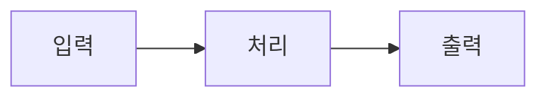

## 📌 개요
<!-- 이 PR이 무엇을, 왜 하는지 한두 문장으로 요약해주세요. -->


**관련 이슈:** #

---

## 🏗️ 아키텍처
<!-- 변경된 구조, 새로 추가된 모듈/컴포넌트, 데이터 흐름을 설명해주세요. 필요하면 다이어그램이나 Mermaid를 활용하세요. -->

- **변경/추가된 모듈:**
- **의존성 변화:**
- **설계 결정과 이유:**



---

## ✅ 기대 작업 (What this PR does)
<!-- 이 PR로 완료되는 작업을 체크리스트로 적어주세요. -->

- [ ]
- [ ]
- [ ]

---

## 🔄 인풋 / 아웃풋
<!-- 함수, API, 컴포넌트 등의 입력과 출력을 명시해주세요. 예시가 있으면 리뷰가 훨씬 쉬워집니다. -->

### Input
| 항목 | 타입 | 설명 | 예시 |
|------|------|------|------|
|      |      |      |      |

### Output
| 항목 | 타입 | 설명 | 예시 |
|------|------|------|------|
|      |      |      |      |

<details>
<summary>요청/응답 예시 (선택)</summary>

```json

```
</details>

---

## 🚫 의도적으로 제외한 사항
<!-- 이번 PR에서 일부러 다루지 않은 것과 그 이유를 적어주세요. 후속 작업이 있다면 이슈 번호를 연결해주세요. -->

| 제외 항목 | 이유 | 후속 계획 |
|-----------|------|-----------|
|           |      |           |

---

## 🧪 테스트
<!-- 어떻게 검증했는지 적어주세요. -->

- [ ] 단위 테스트 추가/수정
- [ ] 로컬에서 수동 테스트
- **테스트 방법:**

---

## 👀 리뷰어 참고사항
<!-- 특히 봐줬으면 하는 부분, 고민했던 지점, 확신이 없는 부분을 적어주세요. -->

