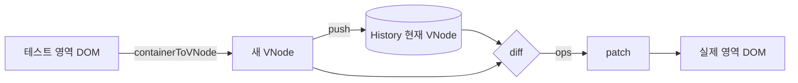

# mini-react

크래프톤 정글 11주차 미니 리액트 구현. 외부 프레임워크 없이 Vanilla JS(ES Modules)로 만든다.

| 단계 | 내용 | 상태 |
|---|---|---|
| Phase 1 | Virtual DOM · Diff · Patch · State History + 검증 페이지 | ✅ |
| Phase 2 | FunctionComponent · useState · useEffect · useMemo | ⬜ |

## 실행

```bash
npm install     # 테스트용 jsdom 만 설치된다 (런타임 의존성 없음)
npm start       # http://localhost:5173  (ES Module 은 file:// 로 열리지 않아 작은 정적 서버를 쓴다)
npm test        # 독립 작성 테스트 94개
```

## Phase 1 — Virtual DOM Lab

```
[ ← 뒤로 ] [ 앞으로 → ] [ Patch ]

┌ 실제 영역 ──────────┐   ┌ 테스트 영역 ─────────┐
│ diff+patch 로만 변경 │   │ 자유롭게 편집 + HTML │
└─────────────────────┘   └──────────────────────┘
  Diff 결과 · State History · 현재 Virtual DOM
```

1. 로드 시 실제 영역의 샘플 HTML → Virtual DOM 변환 → 그 VDOM 으로 테스트 영역 렌더링
2. 테스트 영역(직접 편집 / HTML 코드 편집 / 예시 수정 버튼)을 고친다
3. **Patch** → 테스트 영역을 다시 VDOM 으로 → 이전 VDOM 과 **Diff** → 바뀐 부분만 실제 영역에 **Patch** → History 저장
4. **뒤로/앞으로** (또는 History 항목 클릭) → 두 영역이 함께 해당 시점으로 이동

테스트 영역의 변화는 `MutationObserver` 로 감지한다(`src/lab/watcher.js`). 감지는 "신호"일 뿐이고 실제로 달라졌는지는 Diff 가 판정하므로, 글자를 쳤다 지워 원상복구하면 "변경 없음"으로 돌아온다.

"일부만 바뀐다"를 눈으로 확인하는 장치: Diff 결과 목록, 바뀐 노드 노란 깜빡임, 입력창에 쳐 둔 값이 Patch 후에도 유지됨, 매 Patch 후 "실제 DOM ↔ VDOM 일치" 자동 검증.

### 구조

```
src/vdom/            ← 라이브러리 (Phase 2 가 그대로 재사용)
  vnode.js           VNode 정의·정규화, h()
  fromDOM.js         DOM → VDOM  (containerToVNode, htmlToVNode)
  createDOM.js       VDOM → DOM  (createDOM, render, applyProps)
  diff.js            Diff  → 변경 목록(ops)      ※ DOM 을 건드리지 않는 순수 함수
  patch.js           ops → 실제 DOM 반영
  lis.js             최장 증가 부분 수열 (key 재정렬의 최소 이동)
  history.js         State History
  serialize.js       VDOM → HTML 문자열
  safety.js          on*, javascript: 등 차단
src/lab/             ← 검증 페이지 (lab.js: 로직, main.js/css: 화면,
                       watcher.js: 변경 감지, compare.js: 이전/새 VDOM 줄 단위 비교, describe.js: Diff 결과 설명)
tests/independent/   ← node:test + jsdom (구현과 별개로 작성된 테스트)
```

### 데이터 흐름



### Diff 의 연산

| op | 의미 | 과제의 5가지 케이스 |
|---|---|---|
| `CREATE` | 새 노드 삽입 | ① 추가 |
| `REMOVE` | 노드 삭제 | ② 삭제 |
| `REPLACE` | 태그/종류가 달라 통째로 교체 | ③ 교체 |
| `TEXT` | 텍스트(주석) 내용 변경 | ④ 텍스트 변경 |
| `PROPS` | 속성 추가·수정·삭제 | ⑤ 속성 변경 |
| `MOVE` | `key` 가 같은 노드를 새 위치로 이동 | 확장 |

### 설계 결정

- **VNode 는 불변 데이터.** 히스토리가 참조를 그대로 공유해도 안전하다.
- **정규화 규칙으로 DOM ↔ VNode 가 1:1.** 빈 텍스트 없음, 인접 텍스트 병합, 요소 사이 공백·주석 제거(`<pre>` 등은 보존). 그래서 path(자식 인덱스 경로)가 어긋나지 않는다. 샘플 HTML 도 로드 시 VDOM 으로 다시 그려서 이 상태를 보장한다.
- **O(n) 휴리스틱** (React 와 동일): 태그가 다르면 하위 트리를 비교하지 않고 교체, 같은 부모의 자식끼리만 비교.
- **공백 정책.** "줄바꿈을 포함한 공백뿐인 텍스트"만 코드 정렬용으로 보고 버린다. `<b>a</b> <i>b</i>` 사이의 단일 공백은 화면에 보이는 띄어쓰기라 보존한다. (한계: 인라인 요소 사이의 줄바꿈은 브라우저가 공백 하나로 그리지만 여기서는 버린다. CSS 까지 봐야 정확히 구분되므로 단순한 규칙을 택했다.)
- **중복 key 는 같은 순서끼리 짝짓는다(FIFO).** 어떤 정책이든 같은 트리를 비교하면 변경이 없어야 하기 때문이다. contenteditable 에서 Enter/복사로 key 가 복제되어도 Patch 가 깨지지 않는다.
- **`element()` 는 저수준(받은 그대로), `h()` 는 편의 함수.** `h('svg')` 는 SVG 네임스페이스로 간주하고 하위 요소가 물려받는다. `element()` 는 `ns` 를 명시한 대로만 만든다.
- **key 기반 자식 비교.** key 가 없으면 위치로 짝짓는다(= 특수한 경우). key 가 있으면 LIS 로 "안 움직여도 되는 노드"를 구해 이동을 최소화한다. 맨 앞에 항목을 끼워 넣어도 나머지 `<li>` 는 재사용된다.
- **모든 path 는 "변경 전" 기준 + patch 는 4단계로 적용**(대상 찾기 → 제자리 수정 → 분리 → 부모별 오름차순 삽입). 삭제·삽입으로 인덱스가 밀리는 문제를 구조적으로 피한다.
- **Patch 결과 자동 검증.** 실제 DOM 을 다시 VDOM 으로 읽어 기대값과 비교하고, 어긋나면 전체 렌더링으로 복구한 뒤 경고한다.
- **폼 요소는 "현재 값(property)"을 읽고, 쓸 때는 attribute 와 property 를 함께 맞춘다.** 사용자가 타이핑하거나 체크하면 브라우저는 attribute 가 아니라 property 만 바꾼다. DOM → VDOM 변환이 attribute 만 읽으면 Diff 가 그 변경을 못 보고, 반대로 Patch 가 attribute 만 바꾸면 이미 건드린 입력창의 화면 값은 안 바뀐다. (`input`: value·checked, `textarea`: 내용, `option`: selected)
- **입력·체크는 `MutationObserver` 가 못 본다.** property 변경은 DOM 변화가 아니므로 `input`/`change` 이벤트로 따로 감지한다.
- **검증(verify)은 attribute 만 비교한다.** 실제 영역의 입력창에 사용자가 직접 친 값은 VNode 와 달라도 정상이며 Patch 가 보존해야 하기 때문이다.
- **보안.** 테스트 영역은 임의 HTML 을 받으므로 `<template>` 으로 파싱(이미지 로딩·스크립트 실행 없음)하고 `<script>`, `on*`, `srcdoc`, `javascript:` 를 제거한다.

### 의도적으로 제외한 것

| 항목 | 이유 |
|---|---|
| 이벤트 핸들러 속성(`onclick` 등) | 보안상 차단. Phase 2 에서 함수 props 로 다룰 예정 |
| Patch 의 자동 실행 | 변화는 `MutationObserver` 로 감지해 "변경 N건" 만 표시. Patch 는 과제대로 버튼으로 실행 |
| `class`/`style` 의 의미 단위 비교 | 문자열 비교로 충분. 공백만 다른 경우는 변경으로 본다 |

### 테스트

`npm test` — `tests/independent/` 의 94개 (`node:test` + jsdom).

구현과 **다른 작성자(다른 AI)가 이 README 와 모듈 주석만 보고 독립적으로 작성**했다. 구현자가 자기 코드를 자기 가정으로 검증하는 것을 피하기 위해서다. 이 테스트가 처음 실행되었을 때 11건의 버그(중복 key, 폼 `value` 속성 복원, `<pre>` 선행 줄바꿈 등)를 찾아냈고 모두 수정했다.

| 파일 | 검증 |
|---|---|
| 01 | VNode 정규화, HTML 직렬화 ↔ 파싱 왕복 |
| 02 | DOM → VDOM (공백·주석·SVG·폼 현재 값) |
| 03 | Diff 5가지 케이스, key 재정렬(MOVE), 중복 key |
| 04 | Patch 정확성, 미변경 DOM 노드 재사용, 폼 프로퍼티 동기화 |
| 05 | State History |
| 06 | PatchLab 통합 (로드 → 편집 → Patch → 뒤로/앞으로), 변경 감지 |
| 07 | 보안 (`<script>`, `on*`, `javascript:` 난독화 등) |
| 08 | 시드 고정 퍼즈 테스트 2,100쌍 (`diff → patch` 결과 == 목표 트리) |
