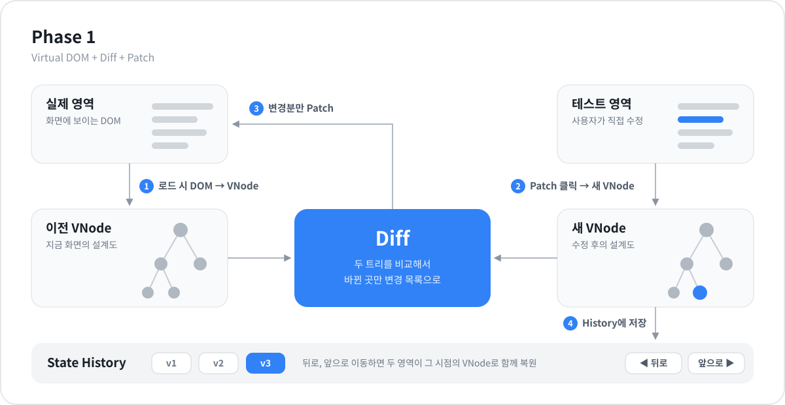
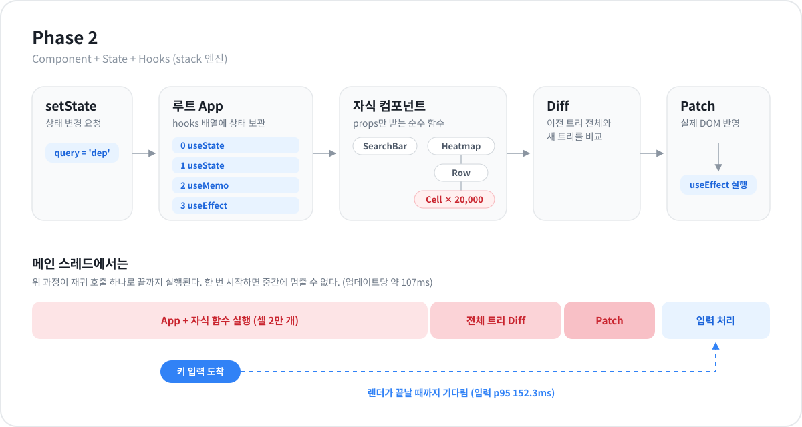
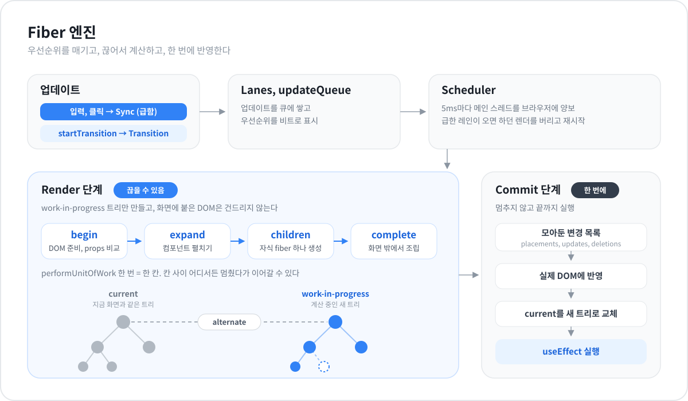
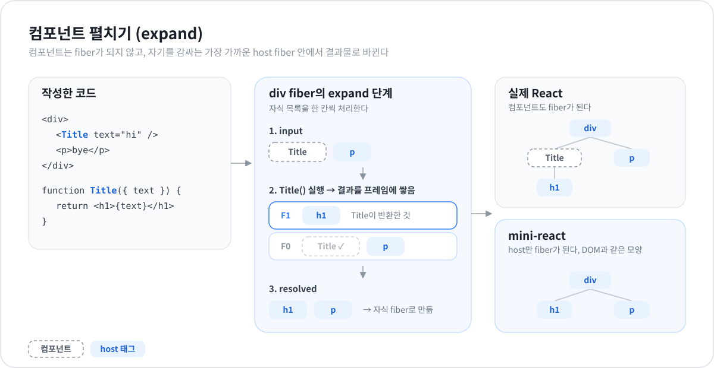
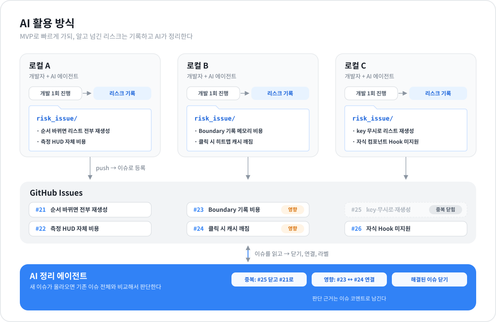

  

크래프톤 정글 11주차 미니 리액트 구현. Phase 1, 2 요구사항을 구현한 뒤, 그 구조의 한계를 해결하기 위해 Fiber 아키텍처를 직접 도입했다.

1. [Phase 1 요구사항](#1-phase-1-요구사항)
2. [Phase 2 요구사항](#2-phase-2-요구사항)
3. [Phase 1, 2 아키텍처](#3-phase-1-2-아키텍처)
4. [문제점](#4-문제점)
5. [Fiber 도입](#5-fiber-도입)
6. [Fiber 아키텍처](#6-fiber-아키텍처)
7. [실제 React와의 차이점: 컴포넌트 처리](#7-실제-react와의-차이점-컴포넌트-처리)
8. [성능 측정](#8-성능-측정)
9. [AI 활용 방식](#9-ai-활용-방식)

---

## 1. Phase 1 요구사항

**Virtual DOM + Diff + Patch**

- 브라우저 DOM을 읽어 Virtual DOM으로 변환한다.
- 두 Virtual DOM을 비교해 바뀐 부분을 찾는 Diff 알고리즘을 만든다.
- 검증 페이지에는 실제 영역, 테스트 영역, Patch, 뒤로가기, 앞으로가기 버튼이 있다.
  - 로드 시 실제 영역을 Virtual DOM으로 변환하고, 그것으로 테스트 영역을 렌더링한다.
  - 사용자가 테스트 영역을 수정하고 Patch를 누르면, 새 Virtual DOM을 만들어 이전 것과 Diff하고 바뀐 부분만 실제 영역에 반영한다.
  - 새 Virtual DOM은 State History에 저장하고, 뒤로/앞으로 이동 시 두 영역이 함께 바뀐다.

## 2. Phase 2 요구사항

**Component + State + Hooks**

- 함수형 컴포넌트를 감싸는 `FunctionComponent` 클래스를 만든다. hooks 배열, `mount()`, `update()`를 가진다.
- `useState`, `useEffect`, `useMemo`를 구현한다.
- Hook과 State는 최상위(루트) 컴포넌트에서만 사용한다. 자식은 props만 받는 순수 함수다(Lifting State Up).
- State가 바뀌면 Phase 1의 Virtual DOM 생성 → Diff → Patch로 바뀐 부분만 다시 그린다.
- Vanilla JS/TS만 사용하고 외부 프레임워크는 쓰지 않는다.

---

## 3. Phase 1, 2 아키텍처

### Phase 1

### Phase 2 (stack 엔진)

루트 컴포넌트만 hooks 배열에 상태를 갖고, 렌더마다 Hook 호출 순서로 같은 슬롯을 찾는다. `setState`가 불리면 루트부터 모든 자식 함수를 재귀로 다시 실행해 새 VNode 트리를 만들고, 이전 트리와 Diff한 뒤 Patch한다.

---

## 4. 문제점

셀 2만 개짜리 히트맵 앱으로 측정하자 stack 엔진에서 세 가지 문제가 드러났다.

| 문제 | 원인 | 측정값 |
|---|---|---|
| 업데이트 한 번에 화면이 멈춘다 | 렌더 → Diff → Patch가 재귀 호출 하나로 끝까지 실행되어 중간에 멈출 수 없다 | 최장 Long Task 122.0ms |
| 입력과 클릭이 늦게 반영된다 | 우선순위가 없어서 급한 입력도 큰 렌더 뒤에 줄을 선다 | 입력 p95 152.3ms, 클릭 p95 190.2ms |
| 바뀐 게 작아도 전부 다시 계산한다 | 상태가 루트에만 있어서 매번 모든 자식 함수를 실행하고 전체 트리를 비교한다 | 커밋당 작업 107.2ms |

브라우저의 메인 스레드는 JS 실행과 화면 그리기를 함께 맡고, 실행 중인 JS를 강제로 멈출 수 없다. 렌더 작업 스스로 잘게 나뉘어 양보할 수 있어야 하고, 급한 작업을 먼저 처리할 수 있어야 한다.

---

## 5. Fiber 도입

문제를 하나씩 풀기 위해 네 단계로 나눠 도입하고, 단계마다 같은 앱에서 측정했다. 각 단계는 바로 앞 단계에서 한 가지씩만 바꿨다.

### B-1 `fiber-sync` · 구조를 Fiber로 바꾸기

| 바뀐 부분 | stack | fiber-sync |
|---|---|---|
| 렌더 방식 | 재귀 호출 | `performUnitOfWork` 반복 루프 |
| DOM 반영 | 비교하면서 바로 Patch | 변경 목록만 모으고, Commit에서 한 번에 반영 |
| 이전 렌더 보관 | 이전 VNode | current / work-in-progress 두 트리 (더블 버퍼링) |
| 메인 스레드 | 끝까지 한 번에 | **여전히 끝까지 한 번에** |
| 입력이 들어오면 | 렌더가 끝날 때까지 대기 | 렌더가 끝날 때까지 대기 |

**결과**: 멈출 수 있는 구조는 생겼지만 실제로 멈추지 않아서 응답성은 거의 그대로다. (진행 바 10.6 → 11.2fps)

### B-2 `fiber-slice` · 5ms마다 양보하기

| 바뀐 부분 | fiber-sync | fiber-slice |
|---|---|---|
| 메인 스레드 | 끝까지 한 번에 | **5ms 일하고 브라우저에 양보, 다음 태스크에서 이어서** |
| 우선순위 | 없음 | 없음 (모든 업데이트가 한 줄) |
| 입력이 들어오면 | 렌더가 끝날 때까지 대기 | 쪼개진 렌더가 전부 끝날 때까지 대기 |

**결과**: 렌더 사이사이 브라우저가 화면을 그릴 수 있어 멈춤은 줄었다. 하지만 입력은 여전히 앞의 렌더 뒤에 줄을 서고, 렌더가 길게 늘어진 만큼 더 오래 기다린다. (최장 Long Task 122.0 → 71.0ms, 입력 p95 152.3 → 481.1ms)

### B-3 `fiber` · 우선순위와 중단

| 바뀐 부분 | fiber-slice | fiber |
|---|---|---|
| 우선순위 | 없음 | **Sync (입력, 클릭) / Transition (`startTransition`)** |
| 진행 중 렌더 | 끝까지 진행 | Sync가 오면 **work-in-progress를 버리고** Sync부터 처리 |
| Transition | 해당 없음 | Sync 커밋 후 current부터 **다시 시작** |
| 입력이 들어오면 | 앞 렌더가 끝날 때까지 대기 | 다음 양보 지점에서 바로 처리 |

**결과**: 입력이 앞의 렌더를 기다리지 않는다. 버린 렌더는 화면에 닿지 않았으므로 안전하다. 다만 Sync 렌더도 전체 트리를 다시 계산한다. (입력 p95 416.2 → 93.2ms, 클릭 p95 402.0 → 88.9ms)

### B-4 `fiber-bailout` · 같은 자식은 건너뛰기

| 바뀐 부분 | fiber | fiber-bailout |
|---|---|---|
| 컴포넌트 펼치기 | 매번 모든 자식 함수 실행 | 같은 위치에 **같은 VNode 객체**가 오면 실행 생략 |
| 서브트리 | 매번 다시 재조정 | 이전 서브트리를 그대로 연결 |
| 앱 | current | cached (루트 `useMemo` 2개로 같은 VNode 유지) |
| 입력이 들어오면 | Sync가 전체 트리 재계산 | Sync가 바뀐 부분만 계산 |

**결과**: 스케줄링이 아니라 일 자체가 줄었다. 입력 한 번에 필요한 Sync 렌더가 거의 사라졌다. (입력 p95 87.2 → 28.2ms, Sync Render 약 61.6 → 0.195ms)

> 괄호 안 수치는 단계마다 같은 세션에서 교차 측정한 값이다.
>
> Fiber는 일을 줄이는 기술이 아니라 일을 나누고 순서를 바꾸는 기술이다. 일 자체를 줄인 것은 B-4의 생략이다.

---

## 6. Fiber 아키텍처

업데이트는 레인으로 우선순위를 받고, Scheduler가 5ms마다 양보하면서 Render 단계를 끊어서 진행한다. Render는 fiber 하나를 begin, expand, children, complete 네 단계로 나눠 `performUnitOfWork` 한 번에 한 칸씩만 진행하고, 결과는 work-in-progress 트리에만 쓴다. 급한 업데이트가 오면 진행 중인 work-in-progress를 버리고 다시 시작해도 화면과 current 트리는 그대로다. 다 끝나면 Commit 단계가 모아둔 변경 목록을 한 번에 DOM에 반영하고 current 트리를 교체한다.

---

## 7. 실제 React와의 차이점: 컴포넌트 처리

가장 큰 차이는 **컴포넌트를 fiber로 만들지 않는다**는 것이다. 컴포넌트는 자기를 감싸는 가장 가까운 host fiber의 expand 단계에서 실행되어, 반환한 태그와 텍스트로 대체된다. 그래서 fiber 트리는 DOM과 같은 모양이 된다.

이 구조가 가능한 것은 Phase 2 규칙 덕분이다. 상태는 루트에만 있고 자식은 순수 함수라서, 자식 컴포넌트는 렌더 사이에 Hook을 보관할 fiber가 필요 없다.

| 항목 | 실제 React | mini-react |
|---|---|---|
| 컴포넌트의 fiber | 컴포넌트마다 fiber를 만든다 | 만들지 않는다. host, text, root만 fiber |
| 컴포넌트 함수 실행 시점 | 그 컴포넌트 fiber의 beginWork | 가장 가까운 host fiber의 expand 단계 |
| 중첩 컴포넌트 처리 | fiber 트리를 따라 내려가며 처리 | host fiber 안의 프레임 스택에 쌓았다가 하나씩 처리 |
| Hook 저장 위치 | 각 컴포넌트 fiber | 루트 fiber만 |
| 생략(bailout) 판단 | 컴포넌트 fiber에서 props 참조, 업데이트 레인, 컨텍스트 확인. `React.memo`는 prop별 `Object.is` 비교 | 같은 host 부모, 같은 위치의 컴포넌트 VNode 객체가 `===`이고 단일 태그를 반환할 때만 |
| 이전 렌더 정보 저장 | 컴포넌트 fiber 자체 | host fiber에 Boundary 기록을 따로 남긴다 |
| 자식 DOM 붙이기 | 컴포넌트 fiber를 건너뛰며 host를 찾아 붙인다 | 직접 자식만 순회하면 된다 |

생략이 걸리려면 루트가 `useMemo`로 같은 자식 VNode 객체를 다시 넘겨야 한다. 자식이 순수 함수이므로 같은 VNode면 같은 결과가 보장되고, 그래서 함수 실행을 건너뛰어도 안전하다.

---

## 8. 성능 측정

셀 하나가 `div` 하나인 배포 지연 히트맵 앱(셀 20,000개)에서 측정했다.

| 엔진 | 앱 | S1 작업 ms/커밋 | S1 최장 Long Task ms | S2 입력 p95 ms | S3 클릭 p95 ms | S4 진행 바 fps |
|---|---|---:|---:|---:|---:|---:|
| `stack` | current | 107.2 | 122.0 | 152.3 | 190.2 | 10.7 |
| `fiber-sync` | current | 96.4 | 111.0 | 138.4 | 170.5 | 11.2 |
| `fiber-slice` | current | 123.4 | 71.0 | 481.1 | 379.7 | 22.0 |
| `fiber` | current | 135.4 | 73.0 | 91.0 | 87.7 | 34.1 |
| `fiber-bailout` | cached | 136.3 | 79.0 | **28.2** | 90.5 | 35.6 |

| 시나리오 | 내용 |
|---|---|
| S1 | 새 데이터 수신을 2초 간격으로 3회 |
| S2 | 100ms 간격으로 19글자 검색어 입력 |
| S3 | 새 데이터 수신 직후 200ms 간격으로 셀 클릭 10회 |
| S4 | 5초 동안 새 데이터 수신을 연속 실행하며 진행 바 갱신 |

조합마다 워밍업 1회를 버리고 3회 평균. 지연은 입력하려던 예정 시각부터 결과가 화면에 반영된 뒤 첫 프레임까지다. 행마다 측정 시점과 빌드가 달라 행 사이 차이를 개선율로 계산하지 않는다.

---

## 9. AI 활용 방식

MVP로 빠르게 진행하면서, 알고도 넘어간 리스크는 버리지 않고 기록했다.

1. **기록:** 각 로컬의 AI 에이전트가 개발을 한 번 진행할 때마다, 이번에 알고 넘긴 리스크를 `risk_issue/` 디렉토리에 정리한다.
2. **등록:** `risk_issue/`의 항목을 GitHub 이슈로 올린다.
3. **정리:** AI가 새 이슈를 기존 이슈 전체와 비교해서, 중복이면 기존 이슈로 합치고 닫고, 서로 영향을 주는 이슈는 연결하고, 이미 해결된 이슈는 닫는다. 판단 근거는 이슈 코멘트로 남긴다.

세 명이 따로 개발해도 같은 리스크가 여러 번 쌓이지 않고, 남은 리스크가 무엇인지 이슈 목록 하나로 볼 수 있다.
