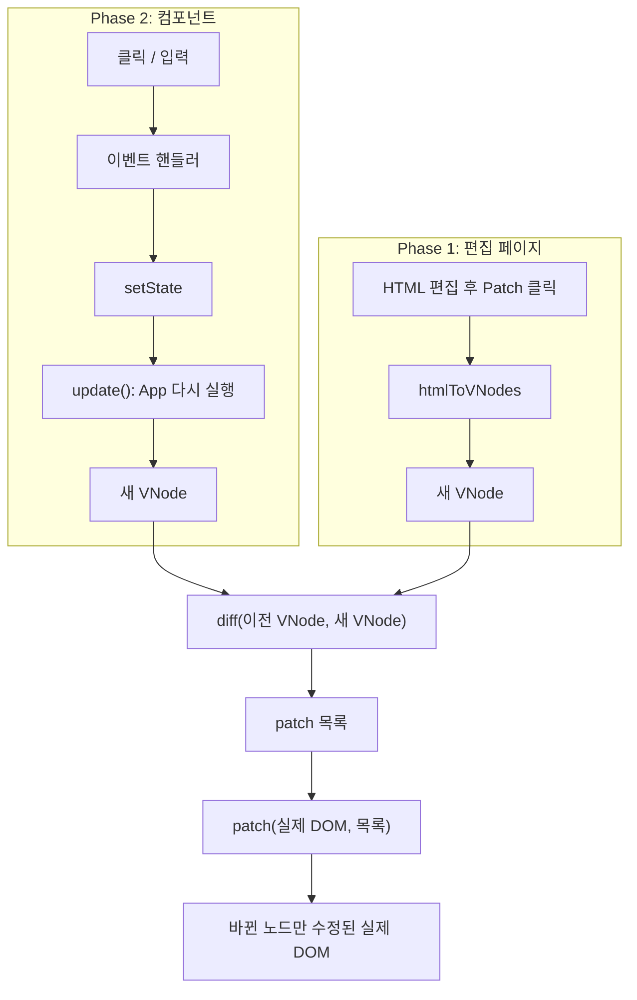
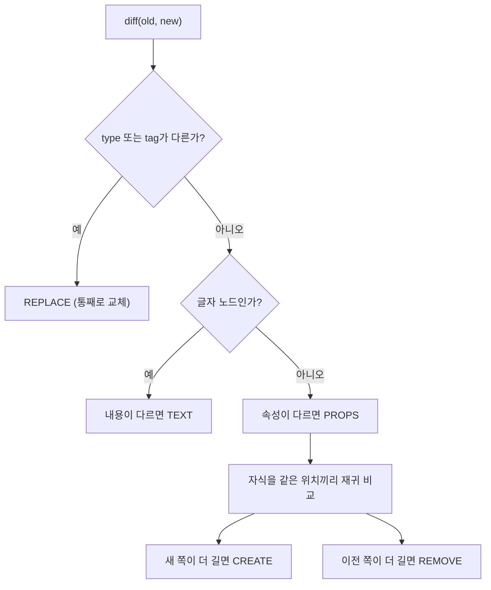
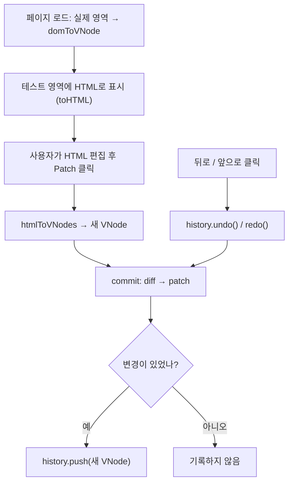
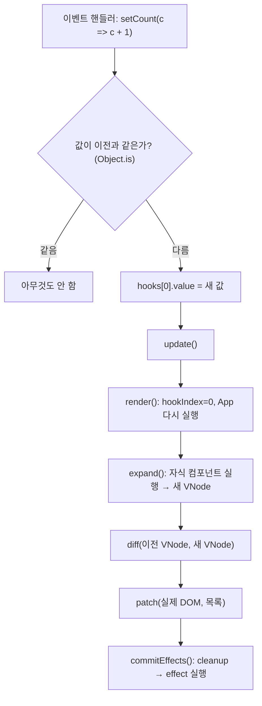

# Mini React

React 없이 **순수 JavaScript**만으로 React의 핵심 원리를 직접 만든 프로젝트입니다.

| | 만든 것 |
|---|---|
| **Phase 1** | Virtual DOM, Diff(변경 찾기), Patch(바뀐 곳만 DOM 수정), 뒤로가기/앞으로가기 |
| **Phase 2** | 함수형 컴포넌트, `useState`, `useEffect`, `useMemo` (Phase 1 엔진을 그대로 재사용) |

---

## 1. 핵심 아이디어 (이것만 이해하면 전부 이해한 것)

1. **VNode**: 화면(DOM)을 흉내 낸 평범한 JS 객체입니다. 만들고 비교하는 게 실제 DOM 조작보다 가볍습니다.
2. **diff**: 이전 VNode와 새 VNode를 비교해서 "무엇을 바꿔야 하는지" **목록만** 만듭니다. DOM은 건드리지 않습니다.
3. **patch**: 그 목록에 있는 곳**만** 실제 DOM을 고칩니다. 목록에 없는 노드는 같은 객체 그대로 남습니다.

> 상태가 바뀌면 → 컴포넌트 함수를 **다시 실행**해서 새 VNode를 만들고 → diff → patch.
> "함수를 다시 실행"과 "DOM이 바뀜"은 **다른 일**입니다. DOM은 오직 patch 안에서만 바뀝니다.

## 2. 실행 방법

```bash
npm install
npm start
```

브라우저에서 `http://localhost:5173`을 열고 Phase 1 또는 Phase 2를 고릅니다.
(ES Module은 `file://`로 열면 막혀서 `server.js`라는 간단한 서버를 씁니다. `npm install`은 테스트용 `jsdom`만 설치합니다.)

```bash
npm test
```

## 3. 전체 흐름



`diff`와 `patch`는 Phase 1에서 만들고, Phase 2도 같은 함수를 가져다 씁니다.

## 4. 파일 구조

| 파일 | 하는 일 |
|---|---|
| [src/vdom.js](src/vdom.js) | VNode 만들기(`h`), DOM ↔ VNode 변환, 속성 반영(`setProp`) |
| [src/diff.js](src/diff.js) | 두 VNode 비교 → patch 목록 |
| [src/patch.js](src/patch.js) | patch 목록을 실제 DOM에 적용 |
| [src/history.js](src/history.js) | VNode 기록 저장, 뒤로/앞으로 |
| [src/phase1-app.js](src/phase1-app.js) | Phase 1 화면 동작 (버튼 → diff → patch) |
| [src/component.js](src/component.js) | `FunctionComponent`, `useState`, `useEffect`, `useMemo` |
| [src/phase2-app.js](src/phase2-app.js) | Phase 2 데모 앱 (카운터, 입력, 할 일 목록) |
| [test/](test) | 테스트 30개 |

---

## 5. VNode, Diff, Patch를 예제 하나로 이해하기

**이전 화면**과 **새 화면**이 이렇게 다르다고 해 봅시다.

```html
<!-- 이전 -->                      <!-- 새 -->
<ul>                                <ul class="list">
  <li>사과</li>                       <li>배</li>
</ul>                                 <li>포도</li>
                                    </ul>
```

### ① VNode: 화면을 객체로 표현

```js
// 이전 <ul><li>사과</li></ul>
{ type: 'element', tag: 'ul', props: {}, children: [
    { type: 'element', tag: 'li', props: {}, children: [
        { type: 'text', text: '사과' } ] } ] }
```

| 필드 | 왜 필요한가 |
|---|---|
| `type` | 요소(`element`)와 글자(`text`)는 만드는 방법이 다릅니다 |
| `tag` | 태그가 다르면 통째로 교체해야 합니다 |
| `props` | 속성(class, id 등)과 이벤트 핸들러를 비교하려고 |
| `children` | 트리 구조를 표현하려고 |
| `text` | 글자 노드의 내용 |

### ② diff: 같은 위치끼리 비교해서 목록 만들기

[diff.js](src/diff.js)의 `diff(old, new)`는 이 순서로 판단합니다.



위 예제의 결과:

```js
[
  { type: 'PROPS',  path: [],     set: { class: 'list' }, remove: [] },   // ul에 class 추가
  { type: 'TEXT',   path: [0, 0], text: '배' },                           // 첫 li의 글자 변경
  { type: 'CREATE', path: [1],    node: <li>포도</li> },                  // 두 번째 li 추가
]
```

- 변경 종류 5가지: **CREATE**(추가), **REMOVE**(삭제), **REPLACE**(교체), **TEXT**(글자 변경), **PROPS**(속성 추가·변경·제거)
- **path**는 루트에서 `childNodes` 번호를 따라가는 주소입니다. `[0, 0]` = `루트.childNodes[0].childNodes[0]`, `[]` = 루트 자신.
- REMOVE는 **뒤에서부터** 만듭니다. `[a,b,c]`에서 앞쪽을 먼저 지우면 뒤 번호가 당겨져서 path가 틀어지기 때문입니다.
- 바뀐 게 없으면 빈 배열 `[]`입니다.

### ③ patch: 목록대로 실제 DOM 수정

[patch.js](src/patch.js)의 `patch(실제DOM, 목록)`이 `path`로 노드를 찾아 DOM 함수를 호출합니다.

| patch | 실제로 호출하는 DOM 함수 |
|---|---|
| CREATE | `parent.insertBefore(새 노드, 기준 노드)` |
| REMOVE | `node.remove()` |
| REPLACE | `old.replaceWith(새 노드)` |
| TEXT | `textNode.nodeValue = 글자` |
| PROPS | `setAttribute` / 이벤트 리스너 교체 (`setProp`) |

`innerHTML`로 영역을 통째로 갈아끼우지 않습니다. 그래서 **바뀌지 않은 노드는 patch 전후로 같은 객체(`===`)**이고, 입력 중인 `<input>`의 커서와 focus도 유지됩니다. (테스트로 확인)

### attribute와 property

`<input value="a">`의 `value="a"`(attribute)는 **처음 값**이고, 사용자가 입력하면 바뀌는 **현재 값**은 `input.value`(property)입니다. 그래서 `setProp`은 `value`, `checked` 같은 값은 property도 같이 설정합니다.

---

## 6. Phase 1: 편집 페이지

화면: 왼쪽 **실제 영역**, 오른쪽 **테스트 영역**(HTML을 직접 고치는 textarea), **Patch / 뒤로가기 / 앞으로가기** 버튼.



- 뒤로/앞으로도 같은 `commit()`을 거쳐서, 실제 영역과 테스트 영역이 항상 같이 바뀝니다.
- [history.js](src/history.js)
  - **새 분기**: 뒤로 간 뒤 새로 Patch하면 앞으로 갈 수 있던 기록은 지워집니다. `[v0,v1,v2]`에서 v1로 돌아가 v3을 저장하면 `[v0,v1,v3]`.
  - **기록 보호**: 저장할 때와 꺼낼 때 `structuredClone`(깊은 복사)을 해서, 나중에 객체를 고쳐도 기록이 바뀌지 않습니다.
- **보안**: 편집한 HTML은 `<template>`에서 파싱해서 스크립트가 실행되지 않고, `script` 태그·`on*` 속성(`onerror` 등)·`javascript:` 링크는 VNode에서 제거합니다. (간단한 필터이며 실서비스용 sanitizer는 아닙니다.)

---

## 7. Phase 2: 컴포넌트, State, Hooks

### 구조

```
FunctionComponent(App)        ← hooks 배열을 가진 유일한 객체
 └─ App()                     ← 루트 컴포넌트: 모든 State와 Hook이 여기에만 있음
     ├─ Counter({count, onIncrement, onDecrement})
     ├─ TodoInput({value, onInput, onAdd})
     ├─ TodoList({todos, ...}) → TodoItem
     └─ Stats({total, done})
```

- 자식은 State가 없고 **props만 받아 VNode를 반환**합니다. 상태를 바꾸려면 부모가 내려준 함수(`onIncrement`)를 호출합니다 (Lifting State Up).
- 자식 컴포넌트(`Counter` 등)는 DOM에 존재하지 않습니다. `expand()`가 함수를 실행해서 결과 요소(`<div class="card">`)로 바꿔 놓기 때문입니다. 컴포넌트 관계와 DOM 관계는 다릅니다.

> **이번 과제만의 제약**: Hook은 루트 컴포넌트에서만 씁니다. 자식에서 Hook을 부르면 에러가 납니다. 실제 React는 모든 함수 컴포넌트가 Hook을 쓸 수 있습니다.

### 실행 흐름



### Hook이 값을 기억하는 방법

값은 `App` 함수 안이 아니라 **`FunctionComponent`의 `hooks` 배열**에 저장됩니다. 그래서 `App()`이 끝나도 사라지지 않습니다. 각 Hook은 호출될 때 `hookIndex`를 1씩 올리며 자기 칸을 찾습니다.

데모 앱 ([phase2-app.js](src/phase2-app.js))의 hooks 배열:

| 칸 | 호출 | 저장되는 값 |
|---|---|---|
| 0 | `useState(0)` | count |
| 1 | `useState('')` | 입력한 글자 |
| 2 | `useState([...])` | 할 일 목록 |
| 3 | `useMemo(…, [todos])` | 완료 개수 + deps |
| 4 | `useEffect(…, [count])` | deps + cleanup |
| 5 | `useEffect(…, [])` | deps + cleanup |

Hook은 이름이 아니라 **호출 순서**로 자기 칸을 찾기 때문에, `if` 안에서 Hook을 부르면 순서가 밀려 엉뚱한 칸을 읽습니다. 이 구현은 칸의 종류(`kind`)를 검사해서 `Hook 호출 순서가 바뀌었습니다` 에러를 냅니다.

| Hook | 동작 |
|---|---|
| `useState` | 처음에만 초기값 저장. `setState`는 자기 칸(`hook`)을 **클로저**로 기억해서, 나중에 클릭해도 같은 칸을 고칩니다. `setX(v => v + 1)` 형태(함수형 업데이트)도 지원합니다 |
| `useEffect` | deps 없음: 매번 실행 / `[]`: 처음 1번 / `[a]`: a가 바뀔 때만. 렌더링 중에는 실행하지 않고 예약해 뒀다가 **patch가 끝난 뒤** 실행합니다. 다시 실행하기 전에 이전 cleanup을 먼저 부릅니다 |
| `useMemo` | deps가 같으면 저장된 값을 그대로 반환(함수 실행 안 함), 바뀌면 다시 계산 |

---

## 8. 실제 값으로 따라가기: count `0 → 1`

Phase 2 페이지에서 `+1`을 한 번 눌렀을 때 실제로 일어난 일입니다.

1. **이벤트**: `+1` 버튼의 핸들러 `() => setCount(c => c + 1)`가 호출됩니다.
2. **setState**: `next(0) = 1`, `Object.is(1, 0)`은 false → `hooks[0].value = 1` → `update()`.
3. **render()**: `App()`이 다시 실행됩니다. `useState(0)`은 초기값을 무시하고 `1`을 반환합니다. `useMemo`는 `todos`가 그대로라 저장값을 재사용하고, `useEffect(…, [count])`는 `[0]`→`[1]`로 바뀌어 실행 예약됩니다.
4. **diff 결과**: 총 9개

```
{"type":"TEXT","path":[0,1,0],"text":"1"}                ← 숫자 글자가 0 → 1
{"type":"PROPS","path":[0,2],"set":{"onClick":…}}        ← 핸들러 교체 ×8
...
```

   - `path [0,1,0]` = `div.app` → `Counter의 div.card` → `p.count` → 글자 노드.
   - PROPS가 8개나 되는 이유: `App()`이 실행될 때마다 `() => setCount(...)` 같은 함수가 **새로 만들어져** 이전 함수와 참조가 다르기 때문입니다. 화면은 그대로이고, 이벤트 리스너만 최신 함수로 바뀝니다.
5. **patch**: `글자노드.nodeValue = '1'`. 어떤 요소도 새로 만들어지거나 교체되지 않았습니다 (`p.count`가 클릭 전후 같은 객체).
6. **commitEffects**: 이전 cleanup("이전 count = 0") → effect 실행(`document.title = "count: 1"`).

---

## 9. 테스트

`npm test` → **30개 통과** (`node:test` + `jsdom`)

| 영역 | 확인한 내용 |
|---|---|
| Virtual DOM | 요소·글자·속성·중첩·빈 노드, 위험 요소 제거, attribute/property |
| Diff | 5가지 변경 각각, 변경 없음, 중첩·여러 변경 동시 |
| Patch | 결과가 새로 만든 DOM과 동일, 바뀌지 않은 노드는 `===` 유지, 리스너가 쌓이지 않음 |
| History | 뒤로/앞으로, 새 분기, 기록이 나중 변경에 오염되지 않음 |
| Component/Hooks | props 전달, `useState`(함수형 업데이트 포함), Hook 순서 오류, `useEffect`(deps·cleanup·실행 순서), `useMemo`, 클릭 → DOM 반영 통합 |

브라우저에서 직접 확인한 것 (`npm start`)
- Phase 1: 글자·속성·노드 추가 patch, 변경된 곳 하이라이트, 뒤로/앞으로, 스크립트 미실행
- Phase 2: 카운터, 입력(같은 input·focus 유지), 목록 추가·체크·삭제, effect/cleanup 로그

미검증: Chrome 외 브라우저, 모바일, 대량 노드 성능.

## 10. 한계 (실제 React와 다른 점)

| 이 프로젝트 | 실제 React |
|---|---|
| `key` 없음. 같은 위치끼리 비교 (맨 앞 항목을 지우면 뒤 항목들의 글자가 바뀌고 마지막이 제거됨) | `key`로 같은 항목을 추적 |
| Hook은 루트 컴포넌트만 | 모든 컴포넌트에서 Hook 사용 가능 |
| `setState`마다 바로 다시 그림 (할 일 추가 1번에 2번 렌더링) | 여러 `setState`를 묶어서 한 번에 처리 |
| 렌더링마다 이벤트 핸들러를 새로 교체 | 이벤트 위임으로 교체 불필요 |
| effect를 patch 직후 같은 흐름에서 실행 | 화면이 그려진 뒤 실행 |

만들지 않은 것: key 재정렬, Fiber, Scheduler, 상태 묶음 처리, Context, useRef.

## 11. 읽는 순서 (추천)

1. Phase 2를 실행해 `+1`을 누르고 오른쪽 patch 로그를 봅니다.
2. 이 문서 3번 흐름도를 보고, 클릭이 DOM 변경까지 가는 길을 말해 봅니다.
3. [vdom.js](src/vdom.js) → [diff.js](src/diff.js) → [patch.js](src/patch.js) (합쳐서 약 300줄)
4. [history.js](src/history.js), [phase1-app.js](src/phase1-app.js)
5. [component.js](src/component.js)의 `render` → `update` → `commitEffects`, 이어서 `nextHook`과 각 Hook
6. 8번 추적을 브라우저 콘솔에서 `app.hooks`를 클릭 전후로 찍어 직접 확인합니다.
