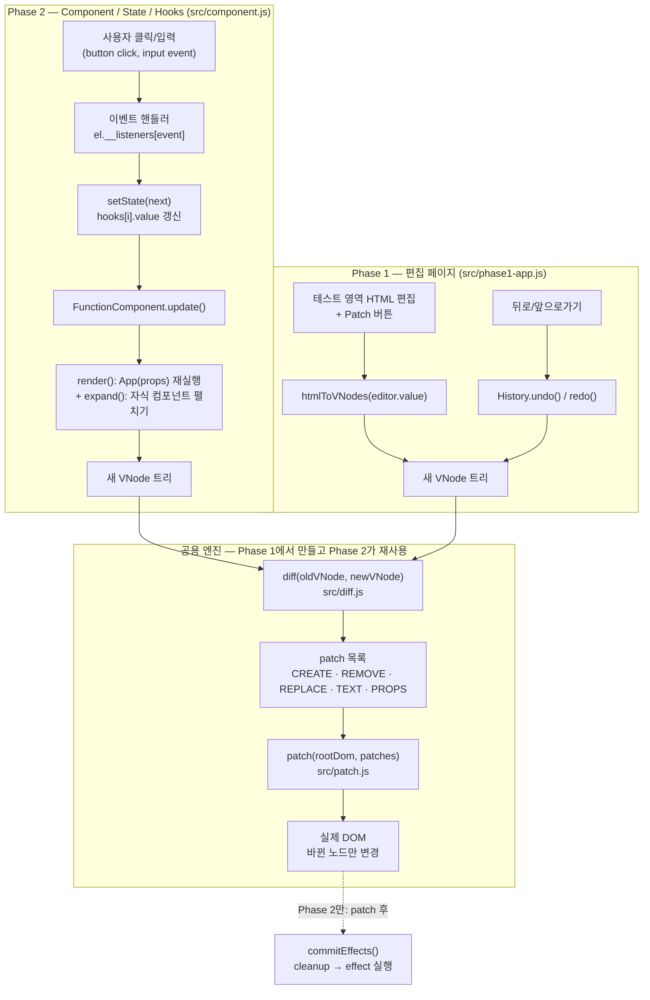
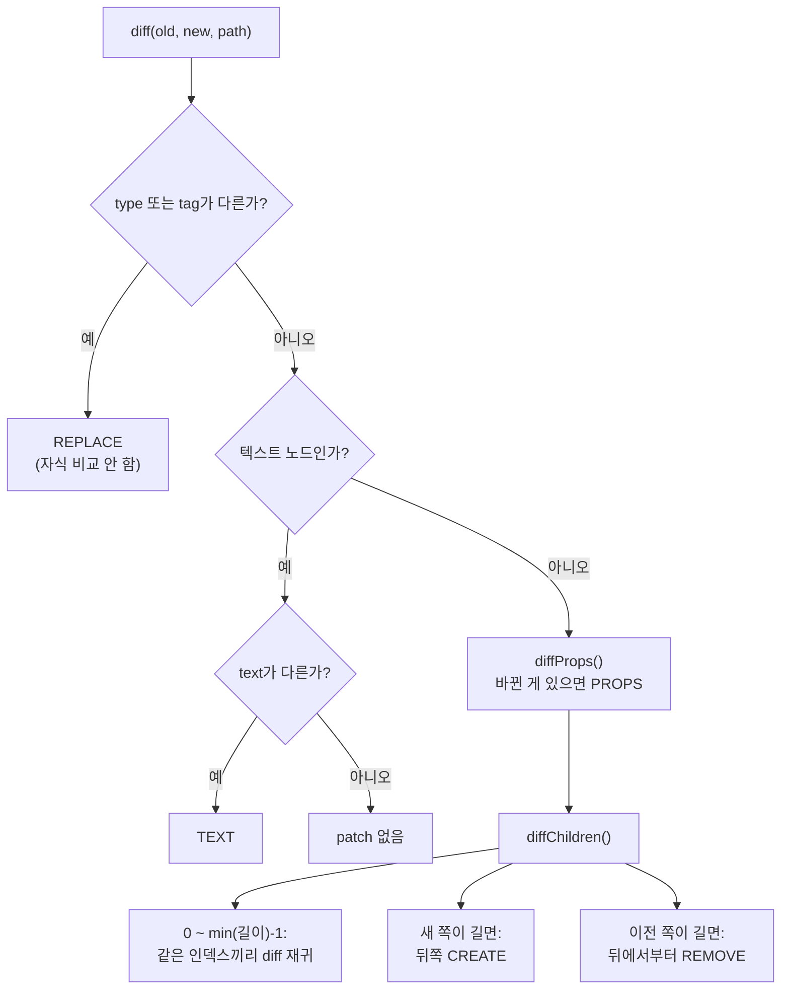
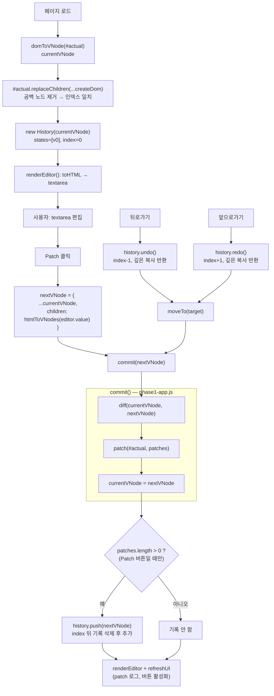
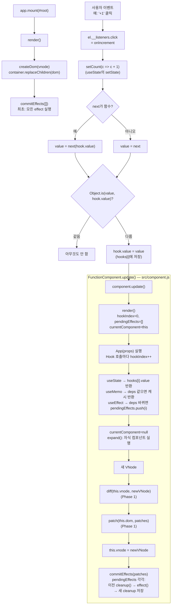

# Mini React — Virtual DOM · Diff · Patch · Component · Hooks

React 없이 **Vanilla JavaScript**만으로 React의 핵심 원리를 직접 구현한 프로젝트입니다.

- **Phase 1**: 실제 DOM → Virtual DOM 변환, 두 Virtual DOM 비교(Diff), 바뀐 부분만 실제 DOM에 반영(Patch), 뒤로가기/앞으로가기(History)
- **Phase 2**: Phase 1 엔진을 그대로 재사용해서 `FunctionComponent`, `useState`, `useEffect`, `useMemo` 구현

> 이 문서 하나만 읽으면 "버튼 클릭이 어떤 함수를 거쳐 화면의 어떤 DOM 노드를 바꾸는지" 코드 줄 단위로 따라갈 수 있도록 썼습니다.
> 모든 함수명·파일 경로·patch 결과는 실제 코드와 실제 실행 결과에서 가져왔습니다.

---

## 0. 5분 요약

```
[Phase 2] 클릭 → setState → FunctionComponent.update() → App() 재실행 → 새 VNode
                                                                         │
[Phase 1] 편집 영역 HTML → htmlToVNodes() → 새 VNode ─────────────────────┤
                                                                         ▼
                                     diff(이전 VNode, 새 VNode) → patch 목록(배열)
                                                                         ▼
                                     patch(실제 DOM, patch 목록) → 바뀐 노드만 수정
```

핵심 아이디어 세 가지:

1. **VNode**는 DOM을 흉내 낸 평범한 JS 객체다. 만들고 비교하는 비용이 실제 DOM 조작보다 싸다.
2. **diff**는 DOM을 전혀 건드리지 않고 "무엇을 바꿔야 하는지" 목록만 만든다.
3. **patch**는 그 목록에 있는 노드만 고친다. 목록에 없는 노드는 **같은 객체(`===`)로 그대로 남는다**.

---

## 1. 전체 실행 흐름도



**구분해야 할 것**: "컴포넌트 함수 재실행"(`render()`)은 **VNode(JS 객체)만 새로 만든다**. 실제 DOM이 바뀌는 순간은 오직 `patch()` 안이다.

---

## 2. 실행 방법

```bash
npm install
```

```bash
npm start
```

브라우저에서 `http://localhost:5173` → Phase 1 / Phase 2 선택.
(ES Module을 쓰기 때문에 `file://`로 HTML을 직접 열면 브라우저가 막습니다. `server.js`는 의존성 없는 정적 서버입니다.)

```bash
npm test
```

`npm install`은 테스트용 `jsdom`(Node에서 DOM을 흉내 내는 라이브러리) 하나만 설치합니다. 앱 코드 자체는 의존성이 없습니다.

---

## 3. 파일 구조와 책임

| 파일 | 책임 | Phase |
|---|---|---|
| [src/vdom.js](src/vdom.js) | VNode 정의, `h()`, 실제 DOM ↔ VNode 변환, 속성 반영(`setProp`), HTML 직렬화 | 1·2 공용 |
| [src/diff.js](src/diff.js) | 두 VNode 비교 → patch 목록 생성 (DOM 조작 없음) | 1·2 공용 |
| [src/patch.js](src/patch.js) | patch 목록을 실제 DOM에 적용 | 1·2 공용 |
| [src/history.js](src/history.js) | VNode 스냅샷 저장, undo/redo | 1 |
| [src/phase1-app.js](src/phase1-app.js) | Phase 1 페이지 컨트롤러 (버튼 → diff/patch/history) | 1 |
| [src/component.js](src/component.js) | `FunctionComponent` 클래스, `useState`/`useEffect`/`useMemo` | 2 |
| [src/phase2-app.js](src/phase2-app.js) | Phase 2 데모 (루트 `App` + Stateless 자식 컴포넌트) | 2 |
| [phase1.html](phase1.html), [phase2.html](phase2.html), [index.html](index.html), [styles.css](styles.css) | 화면 | — |
| [test/phase1.test.js](test/phase1.test.js), [test/phase2.test.js](test/phase2.test.js) | 단위·통합 테스트 30개 | — |
| [server.js](server.js) | 개발용 정적 파일 서버 | — |

**의존 방향**: `phase1-app.js` → `vdom/diff/patch/history` ← `component.js` ← `phase2-app.js`
Phase 2는 diff/patch를 새로 만들지 않고 Phase 1 모듈을 `import`해서 씁니다 ([component.js:7-9](src/component.js:7)).

---

## 4. Virtual DOM (VNode)

### 4.1 모양

```html
<p class="a">hi <b>x</b></p>
```

```js
{
  type: 'element',          // 'element' | 'text' | 'component'
  tag: 'p',                 // 태그 이름 (소문자)
  props: { class: 'a' },    // 속성 + 이벤트 핸들러(Phase 2)
  children: [
    { type: 'text', text: 'hi ' },
    { type: 'element', tag: 'b', props: {}, children: [{ type: 'text', text: 'x' }] }
  ]
}
```

| 필드 | 왜 필요한가 |
|---|---|
| `type` | 텍스트 노드와 요소 노드는 비교 방법도, 만드는 DOM API도 다르다 (`createTextNode` vs `createElement`) |
| `tag` | 태그가 다르면 diff가 하위 비교 없이 통째로 교체(REPLACE)한다 |
| `props` | 속성 추가·변경·제거를 비교하기 위해 |
| `children` | 트리 구조. diff가 같은 인덱스끼리 재귀 비교한다 |
| `text` | 텍스트 노드의 내용. TEXT patch의 대상 |

`type: 'component'`는 Phase 2에서 `h(Counter, props)`가 만드는 **임시 노드**입니다. `FunctionComponent.render()`의 `expand()`가 실행해서 요소/텍스트 VNode로 바꾸므로 **diff와 patch는 component 노드를 절대 보지 않습니다.**

### 4.2 변환 함수

| 함수 | 입력 → 출력 | 위치 |
|---|---|---|
| `domToVNode(node)` | 실제 DOM 노드 → VNode (재귀) | [vdom.js:44](src/vdom.js:44) |
| `childrenToVNodes(parent)` | 자식 노드들 → VNode 배열. **공백만 있는 텍스트 노드는 버림** | [vdom.js:59](src/vdom.js:59) |
| `htmlToVNodes(html)` | HTML 문자열 → VNode 배열 (`<template>`로 파싱) | [vdom.js:71](src/vdom.js:71) |
| `h(tag, props, ...children)` | JS 코드로 VNode 생성 (JSX 대용) | [vdom.js:25](src/vdom.js:25) |
| `createDom(vnode)` | VNode → 실제 DOM (재귀) | [vdom.js:86](src/vdom.js:86) |
| `toHTML(vnode)` | VNode → 들여쓴 HTML 문자열 (편집 영역 표시용) | [vdom.js:140](src/vdom.js:140) |

**공백 텍스트를 버리는 이유**: HTML 소스의 줄바꿈·들여쓰기도 브라우저에선 텍스트 노드입니다. 이걸 VNode에 넣지 않으면 VNode `children[1]`과 DOM `childNodes[1]`이 서로 다른 노드를 가리키게 됩니다. 그래서 Phase 1은 시작할 때 실제 영역을 VNode로 **한 번 다시 그려서** 두 인덱스를 일치시킵니다 ([phase1-app.js:19-22](src/phase1-app.js:19)).

### 4.3 attribute vs property

| | attribute | property |
|---|---|---|
| 무엇 | HTML 태그에 적힌 문자열 (`<input value="a">`) | DOM 객체의 JS 값 (`input.value`) |
| 의미 | **초기값** | **현재 화면에 보이는 값** |
| 사용자가 입력하면 | 안 바뀜 | 바뀜 |

그래서 `setProp` ([vdom.js:98](src/vdom.js:98))은 키에 따라 다르게 처리합니다.

- `onClick`, `onInput` 등 (함수) → `addEventListener`. 이전 리스너는 `el.__listeners`에 기억해 두었다가 **먼저 제거** → 리스너 누적 방지
- `value` → attribute와 property를 **둘 다** 설정. property는 값이 다를 때만 써서 입력 중 커서가 튀지 않게 함
- `checked`, `selected`, `disabled` → property(`el.checked = true`) + attribute 유무. HTML 규칙대로 `checked=""`도 true
- 그 외 → `setAttribute`

### 4.4 보안 (Phase 1 임의 HTML 편집)

- `<template>.innerHTML`로 파싱하면 그 안의 `<script>`는 **실행되지 않습니다**.
- `domToVNode`가 `script/iframe/object/embed` 태그, `on*` 속성(`onerror=` 등), `javascript:` 링크를 VNode에서 제외합니다 ([vdom.js:77](src/vdom.js:77)).
- 브라우저에서 `<script>window.__x=1</script>`를 넣고 Patch → `window.__x`는 `undefined`, 실제 영역엔 ``만 들어감을 확인했습니다.
- 학습용 최소 필터입니다. 실서비스 수준의 sanitizer(DOMPurify 등)를 대체하지 않습니다.

---

## 5. Diff — [src/diff.js](src/diff.js)

### 5.1 출력: patch 목록

```js
{ type: 'CREATE',  path: [2, 2], node: {...} }   // 1. 노드 추가 (path 마지막 = 끼울 인덱스)
{ type: 'REMOVE',  path: [1] }                     // 2. 노드 삭제
{ type: 'REPLACE', path: [0], node: {...} }        // 3. 타입/태그 변경 → 교체
{ type: 'TEXT',    path: [1, 1, 0], text: '55%' }  // 4. 텍스트 변경
{ type: 'PROPS',   path: [0], set: {class: 'x'}, remove: ['id'], removed: {id: 'old'} } // 5. 속성
```

**`path`** = 루트에서 시작해 `childNodes` 인덱스를 차례로 따라가는 주소. `[1, 1, 0]`은 `root.childNodes[1].childNodes[1].childNodes[0]`. `[]`는 루트 자신.

### 5.2 알고리즘 ([diff.js:15](src/diff.js:15))



- **속성 비교** ([diff.js:37](src/diff.js:37)): 새 props의 키 중 값이 다르면 `set`, 이전에만 있던 키는 `remove`. 비교는 `Object.is` (함수는 참조가 같아야 같음).
- **자식 비교** ([diff.js:53](src/diff.js:53)): **같은 인덱스끼리**만 비교. 추가는 항상 뒤쪽, 삭제도 항상 뒤쪽에서 일어납니다.
- **REMOVE를 뒤에서부터 내는 이유**: `[a, b, c]`에서 1, 2번을 지울 때 1번을 먼저 지우면 c가 1번으로 당겨져 `path [2]`가 존재하지 않게 됩니다. 그래서 `[2]` → `[1]` 순서로 냅니다.
- **변경 없음** → 빈 배열 `[]`. (Phase 1에서는 History에 저장하지 않음)

> **하지 않는 것**: key 기반 재정렬은 구현하지 않았습니다. 따라서 "수학적으로 최소한의 수정"을 보장하지 않습니다. 예: 목록 맨 앞 항목 삭제 시 "첫 `<li>` 제거"가 아니라 "앞 `<li>`들의 텍스트 변경 + 마지막 `<li>` 제거"가 됩니다 (§10 참고).

---

## 6. Patch — [src/patch.js](src/patch.js)

`patch(rootDom, patches)` ([patch.js:8](src/patch.js:8))가 목록을 순서대로 실행합니다. `getNode(root, path)` ([patch.js:48](src/patch.js:48))로 대상 노드를 찾습니다.

| patch | 실제 DOM API |
|---|---|
| CREATE | `parent.insertBefore(createDom(node), parent.childNodes[index] ?? null)` |
| REMOVE | `node.remove()` |
| REPLACE | `oldNode.replaceWith(createDom(node))` — 루트가 교체되면 새 루트를 반환 |
| TEXT | `textNode.nodeValue = text` |
| PROPS | `set`의 각 키 → `setProp`, `remove`의 각 키 → `removeProp` |

- `innerHTML`로 영역 전체를 갈아끼우지 않습니다.
- 테스트로 확인: 텍스트/속성만 바뀐 `<h1>`, 바뀌지 않은 `<p>`, 그대로인 첫 `<li>`는 patch 후에도 **`===` 동일 객체** ([test/phase1.test.js](test/phase1.test.js) "patch: 5가지 변경 반영…").
- 같은 노드가 유지되므로 `<input>`의 focus·커서도 유지됩니다 (REPLACE 되는 경우는 예외).

---

## 7. Phase 1 상세 흐름 — Virtual DOM / Diff / Patch / History



과제의 필수 동작 1~8과 코드 대응:

| # | 동작 | 코드 |
|---|---|---|
| 1 | 실제 영역 → VNode | `domToVNode(actual)` [phase1-app.js:19](src/phase1-app.js:19) |
| 2 | VNode로 테스트 영역 렌더링 | `renderEditor()` → `toHTML()` [phase1-app.js:59](src/phase1-app.js:59) |
| 3 | 사용자가 수정 | `<textarea id="editor">` |
| 4 | 테스트 영역 → 새 VNode | `htmlToVNodes(editor.value)` [phase1-app.js:33](src/phase1-app.js:33) |
| 5 | 이전 VNode와 diff | `commit()` 안의 `diff()` [phase1-app.js:51](src/phase1-app.js:51) |
| 6 | 바뀐 부분만 patch | `patch(actual, patches)` |
| 7 | History 저장 | `history.push(nextVNode)` |
| 8 | 뒤로/앞으로 | `moveTo(history.undo())` → 같은 `commit()` 경로로 실제 영역과 편집 영역 동시 갱신 |

**History 세부** ([history.js](src/history.js)):

- **Redo 분기 처리**: `[v0, v1, v2]`에서 v1로 undo 후 새 v3를 저장하면 `states.slice(0, index+1)`로 v2를 버려 `[v0, v1, v3]`가 됩니다.
- **스냅샷 오염 방지**: `push`와 `current` 모두 `structuredClone`(깊은 복사). 저장 후 원본 객체를 고치거나, 꺼낸 객체를 고쳐도 기록은 그대로입니다 (테스트로 확인).

**실제 브라우저 실행 예** (샘플에서 `80%`→`55%`, `센서 정상`→`센서 점검`, `<li>카메라 정상</li>` 추가, h3 class에 `warn` 추가):

```
{"type":"PROPS","path":[0],"set":{"class":"title warn"},"remove":[],"removed":{}}
{"type":"TEXT","path":[1,1,0],"text":"55%"}
{"type":"TEXT","path":[2,1,0],"text":"센서 점검"}
{"type":"CREATE","path":[2,2],"node":{"type":"element","tag":"li","props":{},"children":[{"type":"text","text":"카메라 정상"}]}}
```

→ `<h3>`, `<ul>`은 patch 전후 같은 객체였고, 뒤로가기 시 실제 영역·편집 영역 모두 원래대로 돌아왔습니다.

---

## 8. Phase 2 상세 흐름 — Component / State / Hooks

### 8.1 구조

```
FunctionComponent(App)          ← hooks 배열을 가진 유일한 객체
 └─ App()                       ← 루트 컴포넌트: 모든 State와 Hook
     ├─ Counter({count, onIncrement, onDecrement})   ← Stateless 자식
     ├─ TodoInput({value, onInput, onAdd})
     ├─ TodoList({todos, onToggle, onRemove})
     │    └─ TodoItem({todo, onToggle, onRemove})
     └─ Stats({total, done})
```

데모의 hooks 배열 ([phase2-app.js:67](src/phase2-app.js:67)):

| 인덱스 | 호출 | 저장 내용 |
|---|---|---|
| 0 | `useState(0)` | `{kind:'state', value: count}` |
| 1 | `useState('')` | `{kind:'state', value: text}` |
| 2 | `useState([...])` | `{kind:'state', value: todos}` |
| 3 | `useMemo(..., [todos])` | `{kind:'memo', value: doneCount, deps:[todos]}` |
| 4 | `useEffect(..., [count])` | `{kind:'effect', deps:[count], effect, cleanup}` |
| 5 | `useEffect(..., [])` | `{kind:'effect', deps:[], effect, cleanup}` |

**컴포넌트 관계 ≠ DOM 관계**: `Counter`는 DOM에 존재하지 않습니다. `expand()` ([component.js:110](src/component.js:110))가 `Counter(props)`를 실행해서 반환된 `<div class="card">`로 바꿔치기하기 때문에, 최종 VNode/DOM에는 `div.app > div.card > p.count` 같은 요소만 남습니다.

**Lifting State Up**: 자식은 State가 없고, 바꾸고 싶으면 부모가 내려준 콜백(`onIncrement`)을 호출합니다. 그 콜백이 루트의 `setCount`를 부릅니다.

> **과제만의 제약**: Hook은 루트 컴포넌트에서만 쓸 수 있습니다. 자식에서 `useState`를 부르면 `"Hook은 루트 컴포넌트 함수가 렌더링되는 동안에만…"` 에러가 납니다. 실제 React는 모든 함수 컴포넌트가 각자 Hook/State를 가질 수 있습니다.

### 8.2 흐름도



### 8.3 Hook 동작 원리

모든 Hook은 `nextHook(kind)` ([component.js:119](src/component.js:119))로 시작합니다.

```js
const index = component.hookIndex++;      // 이번 Hook의 칸 번호, 다음 Hook을 위해 +1
const hook = component.hooks[index];      // 이전 렌더링에서 이 칸에 저장된 값
```

Hook 함수는 자기가 "몇 번째 Hook인지" 이름으로 알 수 없습니다. **호출 순서(인덱스)만이 유일한 식별자**입니다. 그래서:

- **렌더링 사이에 State가 유지되는 이유**: `hooks` 배열은 `App` 함수 안이 아니라 `FunctionComponent` 인스턴스에 있습니다. `App()`이 끝나도 사라지지 않습니다.
- **조건문 안에서 Hook을 부르면 안 되는 이유**: 예를 들어 `if (on) useMemo(...)`가 있고 `on`이 `false`가 되면, 그다음 `useEffect`가 1번 칸이 아니라 원래 `useMemo`가 쓰던 칸을 읽게 됩니다. 이 구현은 칸의 `kind`를 검사해서 `"Hook 호출 순서가 바뀌었습니다: 1번 칸은 memo인데 effect로 호출됨"` 에러를 냅니다 (테스트 "조건문 안의 Hook").

**useState** ([component.js:133](src/component.js:133))
- 칸이 비어 있을 때(최초)만 `initialValue`를 저장. 함수면 실행 결과 저장(lazy init).
- `setState`는 `hook` 객체를 **클로저**로 기억합니다. 클릭은 렌더링이 끝난 한참 뒤에 일어나지만, `setState`는 여전히 같은 `hook` 객체를 가리키므로 올바른 칸을 고칩니다.
- 함수형 업데이트 `setCount(c => c + 1)`는 호출 시점의 `hook.value`를 기준으로 계산합니다. 반대로 `setCount(count + 1)`의 `count`는 **그 핸들러가 만들어진 렌더링 시점의 값**(클로저에 갇힌 값)입니다.
- `Object.is`로 같은 값이면 렌더링하지 않습니다.

**useEffect** ([component.js:152](src/component.js:152))

| deps | 실행 시점 |
|---|---|
| 없음 (`undefined`) | 매 렌더링 후 |
| `[]` | 최초 렌더링 후 1번 |
| `[a, b]` | 최초 + `a`나 `b`가 `Object.is` 기준으로 바뀐 렌더링 후 |

- 렌더링 중에는 실행하지 않고 인덱스만 `pendingEffects`에 넣습니다. **patch로 DOM이 바뀐 다음** `commitEffects()`가 실행하므로 effect 안에서 최신 DOM을 읽을 수 있습니다 (테스트로 확인: effect 안에서 `container.textContent`가 이미 새 값).
- 재실행 직전에 이전 effect가 반환한 cleanup을 먼저 부릅니다. `unmount()` 시 남은 cleanup을 모두 부릅니다.
- effect 안에서 `setState`를 부르면 `isUpdating` 플래그 때문에 즉시 중첩 렌더링하지 않고, 현재 갱신이 끝난 뒤 한 번 더 `update()`합니다.
- 실제 React의 실행 시점(브라우저 paint 이후 비동기 실행 등)과 똑같지 않습니다. 이 구현은 **patch 직후 같은 호출 스택 안에서 동기적으로** 실행합니다.

**useMemo** ([component.js:165](src/component.js:165))
- deps가 같으면 저장된 값을 그대로 반환하고 `factory`를 호출하지 않습니다.
- 데모에서 입력창에 글자를 칠 때마다 App이 재실행되지만 `todos` 참조가 같아서 "useMemo 재계산" 로그가 찍히지 않습니다. 할 일을 추가/토글/삭제하면 `todos`가 새 배열이 되어 재계산됩니다.
- 항상 빨라지는 것은 아닙니다. deps 비교와 캐시 저장도 비용이므로 계산이 가벼우면 이득이 없습니다.

---

## 9. 실제 값으로 1회 추적 — count `0 → 1`

브라우저에서 Phase 2 페이지를 열고 `+1` 버튼을 1번 클릭했을 때 실제로 일어난 일입니다.

**① 이벤트** — `+1` 버튼의 `el.__listeners.click`은 렌더링 때 `setProp`이 등록한 `onIncrement: () => setCount((c) => c + 1)`. 브라우저가 이 함수를 `MouseEvent` 인수로 호출합니다.

**② setState** — `next = (c) => c + 1`은 함수이므로 `value = next(hook.value) = next(0) = 1`. `Object.is(1, 0)`은 false → `hooks[0].value = 1` → `app.update()`.

**③ render()** — `hookIndex = 0`, `pendingEffects = []`, `currentComponent = app`, `App()` 재실행:

| 호출 | hookIndex | 결과 |
|---|---|---|
| `useState(0)` | 0 | 칸이 있으므로 초기값 무시, `count = 1` |
| `useState('')` | 1 | `text = ''` |
| `useState([...])` | 2 | `todos` = 이전과 **같은 배열 참조** |
| `useMemo(.., [todos])` | 3 | deps 같음 → 캐시 `1` 반환 (재계산 로그 없음) |
| `useEffect(.., [count])` | 4 | 이전 deps `[0]` vs `[1]` → 바뀜 → `pendingEffects = [4]` |
| `useEffect(.., [])` | 5 | `[]` vs `[]` → 안 바뀜 |

이어서 `expand()`가 `Counter({count: 1, ...})` 등을 실행해 순수 VNode 트리를 만듭니다.

**④ 이전/새 VNode (Counter 부분)**

```js
// 이전                                         // 새
{ tag:'div', props:{class:'card'}, children:[   { tag:'div', props:{class:'card'}, children:[
  { tag:'h2', ... '카운터' },                      { tag:'h2', ... '카운터' },
  { tag:'p', props:{class:'count'},               { tag:'p', props:{class:'count'},
    children:[{type:'text', text:'0'}] },           children:[{type:'text', text:'1'}] },
  { tag:'button', props:{onClick: f1}, ...'-1' }, { tag:'button', props:{onClick: f1'}, ...'-1' },
  { tag:'button', props:{onClick: f2}, ...'+1' }, { tag:'button', props:{onClick: f2'}, ...'+1' },
]}                                              ]}
```

**⑤ diff 결과** — 실제 화면의 patch 로그 그대로 (9개):

```
{"type":"TEXT","path":[0,1,0],"text":"1"}
{"type":"PROPS","path":[0,2],"set":{"onClick":"[function onDecrement]"}, ...}
{"type":"PROPS","path":[0,3],"set":{"onClick":"[function onIncrement]"}, ...}
{"type":"PROPS","path":[1,1],"set":{"onInput":...,"onKeydown":...}, ...}
{"type":"PROPS","path":[1,2],"set":{"onClick":"[function addTodo]"}, ...}
{"type":"PROPS","path":[2,1,0,0],"set":{"onChange":...}, ...}
{"type":"PROPS","path":[2,1,0,2],"set":{"onClick":...}, ...}
{"type":"PROPS","path":[2,1,1,0],"set":{"onChange":...}, ...}
{"type":"PROPS","path":[2,1,1,2],"set":{"onClick":...}, ...}
```

- `path [0,1,0]` = `div.app` → 0번 자식 `div.card`(Counter) → 1번 자식 `p.count` → 0번 자식 텍스트 노드.
- PROPS 8개는 왜? `App()`이 재실행될 때마다 `() => setCount(...)` 같은 화살표 함수가 **새로 만들어져** 참조가 달라지기 때문입니다 (`Object.is(f1, f1')`은 false). 화면은 그대로지만 리스너는 최신 클로저로 교체됩니다.

**⑥ patch** — `getNode(dom, [0,1,0]).nodeValue = '1'`: 텍스트 노드 하나의 값만 바뀝니다. PROPS는 `setProp`이 `removeEventListener(이전)` → `addEventListener(새)`. **어떤 요소도 새로 만들어지거나 교체되지 않았습니다** (`p.count`가 클릭 전후 같은 객체임을 확인).

**⑦ commitEffects** — `pendingEffects = [4]`: 이전 cleanup 실행 → 로그 `cleanup 실행: 이전 count = 0`, 새 effect 실행 → `document.title = "count: 1"`, 로그 `effect 실행: count = 1`, 반환된 함수를 새 cleanup으로 저장. 마지막으로 `onCommit(patches)`가 patch 로그를 화면에 표시.

최종 `app.hooks`: `[1, '', todos, memo(1, [todos]), effect(deps:[1]), effect(deps:[])]`

---

## 10. 함수·파일 매핑표

| 실행 단계 | 실제 함수 | 파일 | 입력 / 핵심 데이터 | 하는 일 | 다음 단계 |
|---|---|---|---|---|---|
| P1 시작 | `domToVNode` | [vdom.js:44](src/vdom.js:44) | `#actual` DOM | DOM 트리 → VNode (위험 요소·공백 제외) | `createDom`으로 재렌더 |
| P1 편집 표시 | `toHTML` | [vdom.js:140](src/vdom.js:140) | VNode | 들여쓴 HTML 문자열 | textarea |
| P1 Patch 클릭 | 클릭 핸들러 | [phase1-app.js:31](src/phase1-app.js:31) | `editor.value` | 새 VNode 생성, 기록 | `commit` |
| P1 파싱 | `htmlToVNodes` | [vdom.js:71](src/vdom.js:71) | HTML 문자열 | `<template>` 파싱 → VNode[] | `commit` |
| P1 반영 | `commit` | [phase1-app.js:51](src/phase1-app.js:51) | `currentVNode`, `nextVNode` | diff → patch → currentVNode 교체 | `history.push` |
| P1 기록 | `History.push/undo/redo` | [history.js](src/history.js) | VNode | 깊은 복사 저장, index 이동, redo 분기 제거 | `moveTo` → `commit` |
| P2 시작 | `FunctionComponent.mount` | [component.js:44](src/component.js:44) | container | render → createDom → effect | 이벤트 대기 |
| P2 이벤트 | `setProp`이 등록한 리스너 | [vdom.js:98](src/vdom.js:98) | `el.__listeners` | 핸들러 호출 | `setState` |
| P2 상태 변경 | `useState`의 `setState` | [component.js:133](src/component.js:133) | `next` (값 또는 함수) | `hooks[i].value` 갱신 | `update` |
| P2 갱신 | `FunctionComponent.update` | [component.js:63](src/component.js:63) | `this.vnode`, `this.dom` | render→diff→patch→effect | `render` |
| P2 재실행 | `FunctionComponent.render` | [component.js:30](src/component.js:30) | `hooks`, `props` | App 실행, Hook 인덱스 초기화 | `expand` |
| P2 Hook 칸 | `nextHook` | [component.js:119](src/component.js:119) | `hookIndex` | 칸 번호 부여, 순서 검사 | 각 Hook |
| P2 캐시 | `useMemo` | [component.js:165](src/component.js:165) | `factory`, `deps` | deps 같으면 캐시 | — |
| P2 effect 예약 | `useEffect` | [component.js:152](src/component.js:152) | `effect`, `deps` | 바뀌면 `pendingEffects`에 추가 | `commitEffects` |
| P2 펼치기 | `expand` | [component.js:110](src/component.js:110) | component VNode | 자식 함수 실행 → 요소 VNode | `diff` |
| 공용 비교 | `diff` / `diffProps` / `diffChildren` | [diff.js:15](src/diff.js:15) | 이전·새 VNode | patch 배열 생성 | `patch` |
| 공용 반영 | `patch` / `getNode` | [patch.js:8](src/patch.js:8) | 루트 DOM, patch 배열 | DOM API 호출 | 화면 갱신 |
| 공용 속성 | `setProp` / `removeProp` | [vdom.js:98](src/vdom.js:98) | el, key, value | attribute/property/리스너 반영 | — |
| 공용 생성 | `createDom` | [vdom.js:86](src/vdom.js:86) | VNode | 실제 DOM 생성 | CREATE/REPLACE/mount |
| P2 effect 실행 | `commitEffects` | [component.js:86](src/component.js:86) | `pendingEffects` | cleanup → effect | `onCommit` |
| P2 제거 | `unmount` | [component.js:99](src/component.js:99) | hooks | 모든 cleanup, DOM 비움 | — |

---

## 11. 테스트

`npm test` → **30개 전부 통과** (Node 24, `node:test` + `jsdom`).

| 영역 | 확인한 내용 |
|---|---|
| Virtual DOM | 요소/텍스트/속성/중첩/공백 무시, 빈 노드, `script`·`on*`·`javascript:` 제거 및 미실행, attribute/property, `toHTML`↔`htmlToVNodes` 왕복 동일 |
| Diff | 5가지 유형 각각, 변경 없음 → `[]`, 중첩 + 여러 변경 동시, REMOVE 역순 |
| Patch | 5가지 반영 결과 = 새로 만든 DOM과 동일, **변경 없는 노드 `===` 유지**, 루트 교체, `value`/`checked` property, 리스너 교체 시 누적 없음, 연속 실행 |
| History | undo/redo, redo 분기 제거, 저장 후·꺼낸 후 수정해도 스냅샷 불변 |
| Phase 1 통합 | 편집 → diff → patch → push → undo → redo |
| Component/Props | 부모→자식 props, `children` 전달 |
| useState | 클릭 갱신 + 같은 `<p>` 유지, 함수형 업데이트, 여러 Hook 인덱스, 같은 값이면 렌더링 생략, 입력 중 같은 `<input>` 유지, 목록 추가/삭제/전체 삭제 |
| 제약 | 자식에서 Hook 호출 → 에러, 조건부 Hook → 순서 에러 |
| useEffect | deps 없음/`[]`/`[값]`, cleanup 순서, patch 이후 실행, unmount cleanup, effect 안 setState |
| useMemo | deps 같으면 재사용, 바뀌면 재계산 |
| 통합 | count 0→1의 diff 결과 = `TEXT [0,0]` + `PROPS [1]` |

**브라우저 수동 확인** (Claude 데스크톱 앱 내장 브라우저, `npm start`):
- Phase 1: 텍스트/속성/추가 patch, 변경 노드 하이라이트, `<h3>`/`<ul>` 동일 객체 유지, 스크립트·`onerror` 미실행, 뒤로/앞으로가기, 변경 없을 때 History 미저장
- Phase 2: +1, 입력(같은 input 유지, focus 유지), Enter로 추가, 체크 토글, 삭제, `document.title` 변경, effect/cleanup/useMemo 로그

**미검증**: Chrome 외 브라우저, 모바일 기기, 대량 노드 성능.

---

## 12. 알려진 한계와 과제 단순화

| 한계 | 결과 | 실제 React |
|---|---|---|
| key 없음, 인덱스 비교 | `[A,B,C]`에서 A 삭제 → li0 텍스트 A→B, li1 텍스트 B→C, li2 REMOVE | `key`로 같은 항목을 추적해 해당 노드만 제거·이동 |
| Hook은 루트 컴포넌트만 | 자식에서 Hook 호출 시 에러 | 모든 함수 컴포넌트가 Hook 사용 가능 |
| setState마다 동기 렌더링 | `addTodo`는 `setTodos` + `setText`로 **렌더링 2번** | 이벤트 안의 여러 setState를 한 번에 묶음(batching) |
| 매 렌더링 핸들러 교체 | 이벤트 prop마다 PROPS patch + 리스너 재등록 | 루트에서 이벤트 위임, 리스너 재등록 없음 |
| effect 동기 실행 | patch 직후 같은 호출 스택에서 실행 | `useEffect`는 paint 이후 비동기 실행 |
| 공백 텍스트 노드 무시 | `<pre>` 안 공백만 있는 줄 등은 사라질 수 있음 | — |
| 최소 보안 필터 | `style`, `data:` URL 등은 걸러지지 않음 | — (React는 문자열을 HTML로 파싱하지 않음) |
| Phase 1은 attribute만 읽음 | 실제 영역 input에 사용자가 입력한 현재값은 VNode에 반영 안 됨 (실제 영역은 편집 대상이 아님) | — |
| REMOVE 시 리스너 정리 안 함 | 제거된 노드의 리스너는 노드와 함께 GC로 회수 | — |

**구현하지 않은 것 (과제 범위 밖)**: key 재정렬, Fiber, Scheduler, Concurrent Rendering, 배칭, Context, useRef 등.

---

## 13. Top-down 학습 경로

처음 읽는 사람에게 권하는 순서입니다. 각 단계 끝의 질문에 **코드와 값으로** 답할 수 있으면 다음으로 넘어가세요.

1. **결과물 보기** — `npm start` → Phase 2에서 +1 클릭, 오른쪽 patch 로그 확인.
   - Q. 숫자가 바뀌었는데 patch 로그에 TEXT 말고 PROPS가 8개 더 있는 이유는?
2. **전체 흐름도** (§1) — 클릭에서 DOM 변경까지 함수 이름만으로 말해 보기.
   - Q. `App()`이 다시 실행되는 순간과 실제 DOM이 바뀌는 순간은 각각 어느 함수 안인가?
3. **모듈** (§3) — Phase 2가 Phase 1의 어떤 함수를 import하는지 [component.js:7-9](src/component.js:7)에서 확인.
4. **VNode** — [vdom.js](src/vdom.js)의 `h` → `createDom` → `setProp`. Phase 1 페이지의 "현재 Virtual DOM 보기" 펼쳐서 실제 객체 확인.
   - Q. `input.value`를 attribute로만 설정하면 사용자가 입력한 뒤 어떤 문제가 생기나?
5. **diff** — [diff.js](src/diff.js) 전체(약 70줄). Phase 1에서 직접 HTML을 바꿔 보며 5가지 patch를 하나씩 만들어 보기.
   - Q. REMOVE를 앞 인덱스부터 내면 어떤 path가 틀어지나? `[a,b,c] → [a]`로 설명.
6. **patch** — [patch.js](src/patch.js). `getNode`가 path를 따라가는 과정을 종이에 그려 보기.
7. **History** — [history.js](src/history.js). `structuredClone`을 지우면 어떤 테스트가 깨지는지 직접 지워 보기.
8. **FunctionComponent** — [component.js](src/component.js)의 `render` → `update` → `commitEffects` 순서.
   - Q. `hooks` 배열이 `App` 함수 안의 지역 변수였다면 어떻게 될까?
9. **Hooks** — `nextHook` → `useState`(클로저) → `useEffect`(pendingEffects) → `useMemo`(deps).
   - Q. `setCount(count + 1)`을 한 핸들러에서 두 번 부르면 결과는 몇이 되나? `setCount(c => c + 1)` 두 번이면?
10. **§9 추적을 혼자 재현** — 브라우저 콘솔에서 `app.hooks`를 클릭 전후로 출력해 비교.
11. **설계 분석** — §12의 한계를 하나 골라, 고치려면 어느 함수를 바꿔야 하는지 설명.

### 관련 JavaScript·CS 개념 ↔ 코드 위치

| 개념 | 이 코드에서 보는 곳 |
|---|---|
| 트리·재귀 | `domToVNode`, `createDom`, `diff`, `expand` (자기 자신을 자식에 대해 다시 호출) |
| 참조 vs 값, `Object.is` | `diffProps`, `depsChanged`, `setState`의 같은 값 검사, `useMemo` 캐시 |
| 클로저 | `setState`가 `hook`을 기억, 핸들러 안의 `count`가 렌더링 시점 값 |
| 깊은 복사 | `History`의 `structuredClone` |
| 모듈 스코프 변수 | `currentComponent` — Hook이 "지금 누구의 hooks인지" 아는 방법 |
| DOM API | `createElement`, `insertBefore`, `replaceWith`, `remove`, `nodeValue`, `addEventListener` |
| attribute/property | `setProp`의 `value`/`checked` 분기 |
| 이벤트 | `el.__listeners`로 리스너 교체 |
| try/finally | `render()`에서 에러가 나도 `currentComponent`를 반드시 해제 |

---

## 용어 정리

| 용어 | 뜻 |
|---|---|
| VNode | 실제 DOM 노드를 흉내 낸 JS 객체 `{type, tag, props, children}` |
| Virtual DOM | VNode로 이루어진 트리 전체 |
| diff | 두 VNode 트리를 비교해 patch 목록을 만드는 일 (DOM 조작 없음) |
| patch | patch 목록대로 실제 DOM을 고치는 일 |
| path | 루트에서 대상 노드까지의 `childNodes` 인덱스 배열 |
| 렌더링(render) | 컴포넌트 함수를 실행해 VNode를 만드는 일. **DOM 변경과 다르다** |
| Hook | 컴포넌트 함수가 렌더링 사이에 값을 기억하게 해 주는 함수 (`useState` 등) |
| deps | 의존성 배열. 이 값들이 바뀌었을 때만 effect/memo를 다시 실행 |
| cleanup | effect가 반환한 함수. 다음 effect 실행 전 또는 unmount 시 호출 |
| Lifting State Up | State를 공통 부모(여기선 루트)로 올리고 자식에겐 props·콜백만 내려주는 패턴 |
